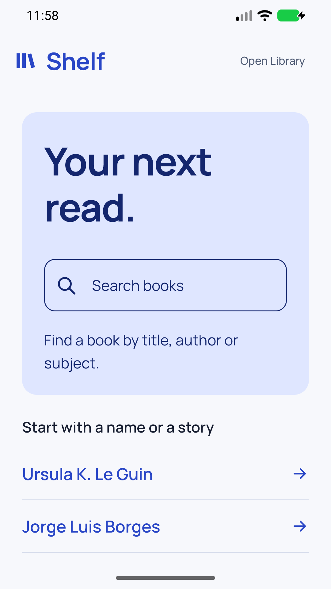
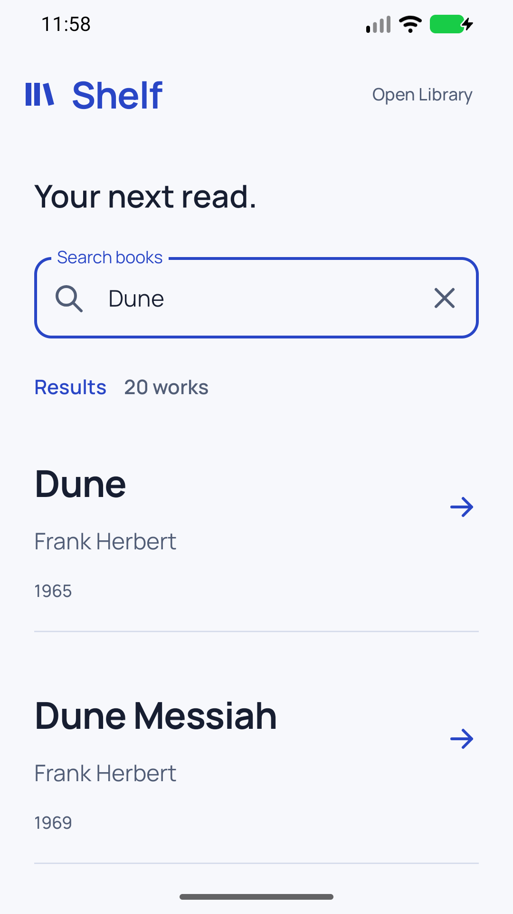
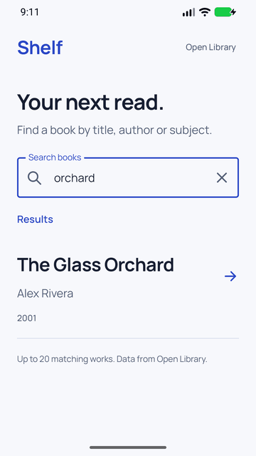

# Shelf · Buscador de libros Android

Aplicación pequeña en Kotlin / Jetpack Compose de Manuel Naval. Busca contra la [API real de Open Library](https://openlibrary.org/dev/docs/api/search) y abre una ficha con autoría, primera publicación, ediciones e identificador.

[English](README.md) · [Arquitectura y guía de revisión](docs/ARCHITECTURE.md) · [Verificación](docs/VERIFICATION.md) · [Sistema de diseño](DESIGN.md) · [CI](https://github.com/navalcode/shelf-android/actions/workflows/checks.yml)

<p>  </p>

App nativa optimizada: apertura y búsqueda real. La navegación de reloj de tests usa un libro ficticio. [Procedencia de imágenes](docs/images/PROVENANCE.json).

## Ejecutar

Android Studio con **JDK 17**, Android SDK **36**, Build Tools **35.0.0** y emulador/dispositivo **API 26+**. Abrir este directorio, sincronizar Gradle y ejecutar `app`. Sin claves, cuentas, backend ni secretos. Los fallos de caché necesitan Internet; producción usa solo HTTPS.

```sh
./gradlew :app:assembleDebug
./gradlew :domain:test :data:test :app:testDebugUnitTest :app:lintDebug
./gradlew :app:connectedDebugAndroidTest  # un emulador/dispositivo conectado
./gradlew :app:bundleRelease            # bundle optimizado sin firma de distribución
```

APK debug: `app/build/outputs/apk/debug/app-debug.apk`. El bundle release no tiene configuración de firma de producción. CI adjunta temporalmente un APK debug y los informes.

## Decisiones

- **Arquitectura:** `domain` es Kotlin puro (modelos, puerto de repositorio y caso de uso); `data` implementa el puerto con Retrofit/caché; `app` contiene Compose, Navigation, ViewModel y DI explícita. Domain y Data no dependen de Android.
- **Cancelación:** cada edición cancela inmediatamente el trabajo en curso y retira sus resultados, antes del debounce de 400 ms. Las llamadas suspend de Retrofit propagan la cancelación a OkHttp. Una generación rechaza respuestas tardías de fuentes no cooperativas. Cancelar nunca muestra un error.
- **Caché:** TTL de 3 minutos **por consulta normalizada**, con reloj monotónico desde el final de red. La igualdad con el TTL ya implica expiración. Un acierto válido no hace HTTP; un resultado vacío también se cachea. Máximo 20 consultas LRU. Fallos/cancelaciones no se guardan, ni se ofrecen datos expirados tras un error. Solo memoria: se pierde al terminar el proceso.
- **Uso de API:** campos explícitos, hasta 20 obras, al menos 1,1 s entre inicios de petición, timeout de 20 s y sin reintentos automáticos. User-Agent del proyecto y límite conservador por defecto, sin atribuir privilegios de cliente identificado. [Guía del servicio](https://openlibrary.org/developers/api). Las consultas se envían a Open Library; la app no incluye analítica ni registro de búsquedas.
- **Estado:** consulta y pequeño snapshot del detalle en SavedStateHandle. Rotar conserva ViewModel; restaurar una tarea puede recuperar esos valores. No se garantiza force-stop/tarea nueva. Detalle sin petición adicional y campos ausentes declarados.

Tipografía Manrope local, recursos españoles con fallback inglés, modo oscuro y texto escalable. Una sola identidad del libro conecta índice y ficha; las preferencias de animación de Android se observan explícitamente. Carga, vacío, error y reintento siguen siendo claros y funcionales. [Contrato de aceptación](docs/SPEC.md).

## Pruebas y licencia

Pruebas deterministas de delegación Domain, expiración exacta, claves, LRU, fallos, cancelación, contrato Retrofit con MockWebServer, debounce y respuestas tardías. Los nueve casos nativos arrancan MainActivity con el grafo real, Retrofit y caché, sustituyendo solo las respuestas HTTP. Comprueban errores, reintento, recreación, teclado, acciones accesibles y metadatos ausentes. API34+ añade comprobaciones automáticas de accesibilidad. Ningún test automatizado depende del servicio público. La red real tiene evidencia separada.

El código original se distribuye con licencia MIT. Los avisos de terceros están en [THIRD_PARTY.md](THIRD_PARTY.md).
