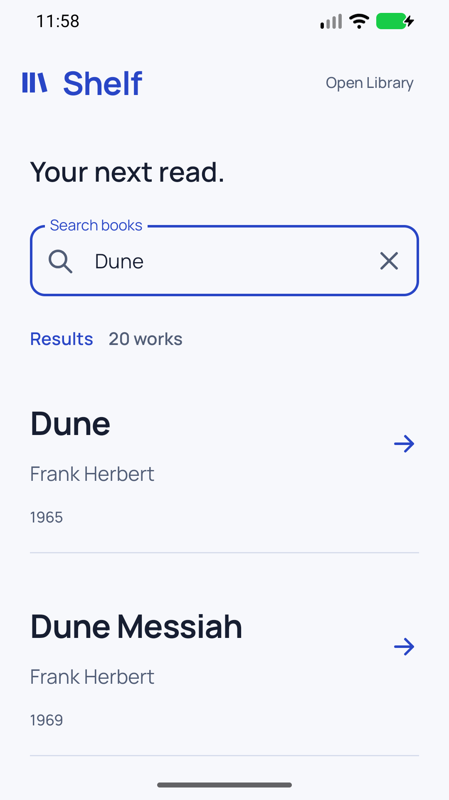
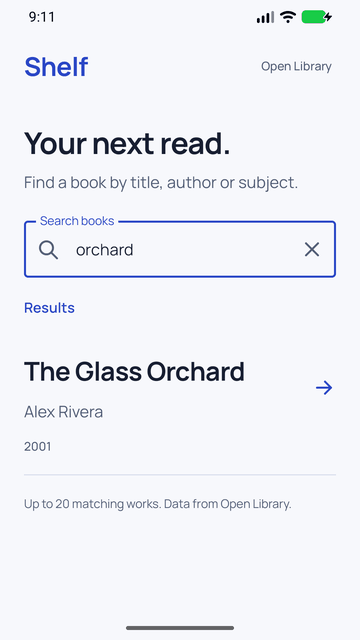

# Shelf · Android book search

A small Kotlin / Jetpack Compose app by Manuel Naval. Search the real [Open Library API](https://openlibrary.org/dev/docs/api/search), open a book and inspect its author, first publication, edition count and catalogue ID.

[Español](README.es.md) · [Architecture and review guide](docs/ARCHITECTURE.md) · [Verification](docs/VERIFICATION.md) · [Design system](DESIGN.md) · [CI](https://github.com/navalcode/shelf-android/actions/workflows/checks.yml)

<p>  </p>

Optimized native app: opening and live API search. Test-clock navigation uses a fictional book. [Image provenance](docs/images/PROVENANCE.json).

## Run

Use Android Studio with **JDK 17**, Android SDK **36**, Build Tools **35.0.0** and an emulator/device on **API 26+**. Open this directory, let Gradle sync, then run `app`. No key, account, backend or secret is needed. Internet access is required on a cache miss; production uses HTTPS only.

```sh
python3 verification/format_kotlin.py --check
./gradlew :app:assembleDebug
./gradlew :domain:test :data:test :app:testDebugUnitTest :app:lintDebug
./gradlew :app:connectedDebugAndroidTest  # one running emulator/device
./gradlew :app:bundleRelease            # optimized, unsigned distribution bundle
```

The debug APK is `app/build/outputs/apk/debug/app-debug.apk`. The release bundle has no production signing configuration. CI publishes temporary debug and QA-signed optimized APKs, a separate signed runtime probe and test reports as workflow artifacts. [Runtime validation](verification/README.md).

## Decisions

- **Architecture:** `domain` is pure Kotlin (models, repository port and use case); `data` implements the port with Retrofit and memory cache; `app` owns Compose, Navigation, ViewModel and explicit dependency wiring. No Android dependency in domain/data.
- **Cancellation:** every edit cancels the current job immediately and clears its results, before a 400 ms debounce. Retrofit suspend calls propagate cancellation to OkHttp. A generation check also rejects late results from non-cooperative sources. Cancellation is never shown as an error.
- **Cache:** 3-minute TTL **per canonical query**, measured with a monotonic clock from network completion. At the exact TTL boundary an entry expires. Valid hits make no HTTP request; empty results count as valid. At most 20 queries, evicted LRU. Failures/cancelled work are not cached; expired data is not served on failure. Memory only, reset on process death.
- **API courtesy:** explicit fields, at most 20 works, at least 1.1 s between request starts, 20 s call timeout and no automatic retry. A project User-Agent is supplied; the app uses the conservative default rate, without claiming identified-client privileges. See [API guidance](https://openlibrary.org/developers/api). Searches are sent to Open Library; there is no analytics or query logging in the app.
- **State:** query and a small detail snapshot use SavedStateHandle. Rotation preserves the ViewModel; Android task restoration can restore those values. A force-stop/new task does not promise restoration. Detail uses the selected result without a second request. Missing metadata is labelled, never invented.

The UI has local Manrope typography, Spanish resources, English fallback, system dark mode and scalable text. A single book identity travels between the open index and its reading sheet; Android’s animation preferences are observed explicitly. Loading, empty, error and retry remain visible and functional. [Acceptance contract](docs/SPEC.md).

## Tests and license

Deterministic tests cover domain delegation, exact cache expiry, canonical keys, LRU, errors, cancellation, the real Retrofit HTTP contract via MockWebServer, debounce and late-response rejection. All nine native cases launch MainActivity with the real application graph, Retrofit and cache, replacing only HTTP responses. They cover errors, retry, activity recreation, keyboard behavior, accessible actions and missing metadata. API34+ adds automated accessibility scans. The deterministic suites and CI do not depend on the public service. The optional live-API runtime probe is separate and documented in verification.

Original code is available under the MIT license. Third-party notices are in [THIRD_PARTY.md](THIRD_PARTY.md).
