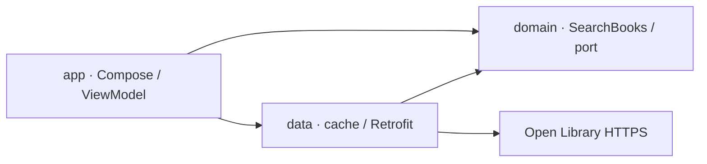

# Architecture and review guide

[Acceptance contract](SPEC.md) maps each behavior to its test or explicit validation limit.

```text
app (Compose → SearchViewModel → SearchBooks)
 ↓                                      ↓
data (CachedBookRepository) → domain (BookRepository)
 ↓
OpenLibrarySource → Retrofit suspend → OkHttp → HTTPS
```

Domain depends only on Kotlin/coroutines; Data depends on Domain. The Android application is the composition root.



Manual DI exposes a single application-scoped repository/cache/source and a lifecycle-owned ViewModel. Unit tests replace the repository port. Every native journey now launches MainActivity with the same application graph and replaces only HTTP responses through a test-only OkHttp interceptor; it retains Retrofit, the cache, timeouts and User-Agent. The test runner and controlled transport exist only in the instrumentation APK.

## Read in this order

1. `domain/.../Books.kt`: models, canonical query, use case and repository contract.
2. `data/.../CachedBookRepository.kt`: short mutex-protected cache operations; no cache lock over network.
3. `data/.../OpenLibrary.kt`: HTTP DTO mapping, validation, client-side result cap and cancellable request pacing.
4. `app/.../presentation/SearchViewModel.kt`: cancel-before-debounce, generation and state.
5. `app/.../presentation/ShelfApp.kt`: navigation and shared-transition boundary.
6. `SearchScreen.kt` / `DetailScreen.kt`: stateless UI and Material affordances; `BookIdentity.kt` connects the selected title/author across the two contexts; `Theme.kt` owns color roles and local typography.

## Concurrency and cache contract

Editing increments a generation, cancels the old job, replaces visible content with loading and starts a new job. Blank input cancels and returns idle without HTTP. Debounce runs inside the new job, so the old request is already cancelled. Retrofit's coroutine adapter connects cancellation to its Call. CancellationException is rethrown before all error handling. A stale generation cannot write success/error even if a substitute repository ignores cancellation.

Cache TTL is 180,000 ms from receipt using elapsedRealtime on Android. The query is trimmed, whitespace collapsed and lowercased using Locale.ROOT before both network and cache. Empty results are cached. Exact expiry is a miss. Failed refresh does not expose an expired entry. LRU bounds memory to 20 queries of at most 20 books each under the normal API contract. Cache and detail snapshot have different lifetimes: selected detail stays readable after expiry; a new search still refreshes its query.

One UI consumer is expected. Cache operations are thread safe; identical concurrent misses are **not coalesced**. Source serializes request starts; cancellation releases that gate and spacing survives cancellation. No persistent cache, offline-first promise, pagination or retry loop. A future multi-consumer app should add keyed single-flight behavior deliberately.

## Validation and limits

Missing required identifiers/title in the consumed works, or a missing document list, reject the returned batch; optional fields remain absent. Data translates HTTP 429, other HTTP errors, I/O failures and invalid payloads into domain error categories. The ViewModel never imports Retrofit, Gson or IOException. A bad response has its own message; it never asks the user to check their connection. Cancellation remains cancellation. The UI never renders raw exceptions, HTML or arbitrary external links. Query snapshots are bounded to 121 characters (120 allowed plus validation feedback). Searches use generic Open Library `q` semantics, including its supported query syntax.

SavedStateHandle stores query and selected fields only; Navigation handles the back stack. System task restoration is conditional on Android retaining saved state. Tests of SavedStateHandle reconstruction do not prove an OS process-death journey. Executed emulator/physical checks and retained-task process-loss evidence are scoped in [Verification](VERIFICATION.md). Production signing, store publishing, human TalkBack and formal accessibility conformance remain unverified.

## Design questions / Preguntas de diseño

- Why cancel before debounce? / ¿Por qué cancelar antes del debounce?
- Why elapsedRealtime instead of wall time? / ¿Por qué reloj monotónico?
- What happens at exact expiry or failed refresh? / ¿Qué ocurre en la expiración exacta o un refresco fallido?
- Why retain a detail snapshot instead of a global selected ID only? / ¿Por qué un snapshot mínimo del detalle?
- What changes for multiple concurrent consumers? / ¿Qué cambia con varios consumidores?

These questions concern the implementation in this repository. Source code and tests provide the basis for discussing each tradeoff.

## UI and motion boundary

The visual layer changes presentation, not cancellation or cache policy. Search results are rendered directly from current state: there is no outgoing-results crossfade that could retain a superseded query. Navigation renders a single selected identity while it travels into the reading sheet. Index/detail allocate identical text width and typography, avoiding a crossfade of incompatible line breaks. Metadata enters after that identity clears the reading area. Android animator/transition settings are observed explicitly in Motion.kt. Zero scale removes shared-element modifiers and navigation/metadata transition specs, including delays; Compose test clocks cannot silently override that preference. No shader, blur loop, animation dependency or background motion is added.

The first viewport offers a tonal search panel, then actual query suggestions, not fake catalogue results. SearchHeader keeps one editing node while its initial display typography compacts during search; IME Search submits immediately and hides the keyboard. From an 800dp window, controls and catalogue have independent scrollable panes; detail separates the selected identity from metadata. Shared layout dimensions live in ShelfLayout; shared text measures at most 264dp regardless of the surrounding pane width. Result actions have explicit localized labels; counts/states announce changes politely and navigation exposes a pane title. The suggestion journey checks domain-normalized input and system Back. Manual DI and the two JVM modules are retained; the visual pass adds no application service or artificial module.

## Runtime and accessibility verification

All nine native cases exercise the production entry and real Retrofit/cache wiring. API 34+ additionally runs Compose Accessibility Test Framework scans; action names, target dimensions, input focus, IME behavior, state recovery and optional metadata are asserted through semantics. These checks do not replace an assistive-technology user review. See [optimized runtime checks](../verification/README.md) for QA signing, cold launch and a retained-task process-loss procedure.

## Reproduce motion evidence

On an owned emulator, set Android animator/transition/window animation scales to 1 for normal motion or 0 for disabled motion, then run:

```sh
./gradlew :app:connectedDebugAndroidTest -Pandroid.testInstrumentationRunnerArguments.motionCapture=true
adb pull /sdcard/Download/shelf-test-output
```

The first journey pauses the Compose clock at 0/16/80/160/240/400 ms for entry and Back. `NativeCapture` handles only evidence; behavioral assertions stay in `ShelfJourneyTest`. Test fixtures are original fiction. Captured frame positions are not hardware frame-time measurements. Restore emulator settings after review.
